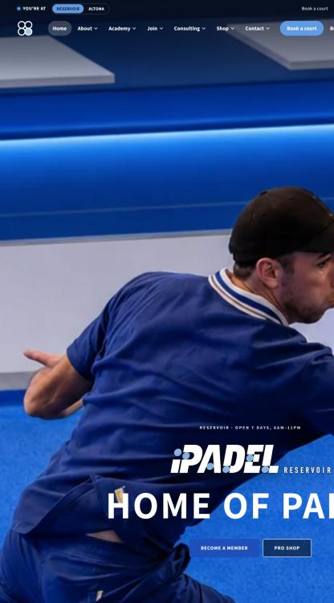
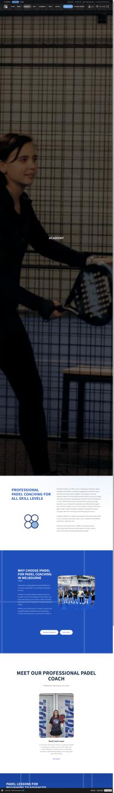
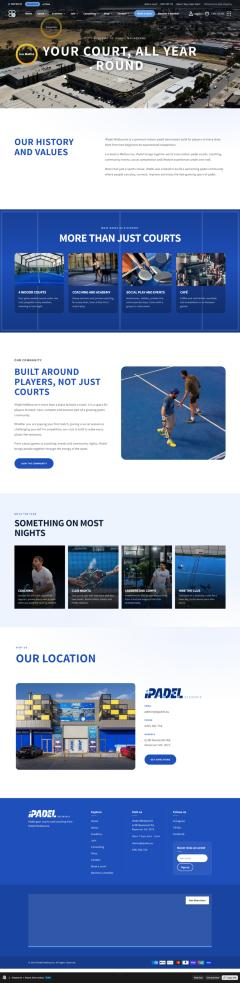

# iPadel Melbourne website

**The online store and website for iPadel, a padel club in Melbourne.** I build and run the site as iPadel's Web Developer / Administrator.

**Live site:** [ipadel.au](https://ipadel.au)

## What I did

- Built and customised the Shopify theme (based on Dawn) with custom sections, navigation and page layouts for each club location.
- Ran a full SEO pass: page and product titles, meta descriptions and image alt text across the catalogue.
- Cleaned up product data: types, vendors, tags and images.
- Improved the layout and mobile responsiveness.
- Before the move to Shopify, administered the WordPress and WooCommerce site: content, products, pricing, plugins and troubleshooting.

## Tech stack

Shopify (Liquid, Online Store 2.0 sections), HTML, CSS, JavaScript, WordPress, WooCommerce.

## Source code

The theme belongs to iPadel, so the code is kept in a private repository.

**Built by Omar Al Azhari** · [LinkedIn](https://www.linkedin.com/in/omar-alazhari-028a6a203)
